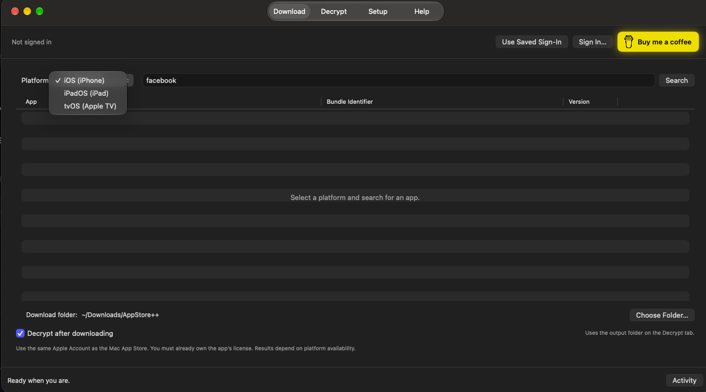

# AppStore++

[**Download AppStore++ for Mac**](https://github.com/bdnus2010/AppStorePlusPlus/releases/latest) · [Support development](https://buymeacoffee.com/100xtoday)

A free native Apple Silicon Mac app for downloading owned iPhone, iPad, and Apple TV IPAs and managing local UnfairPlay decryption.

**Free to use, with optional donations.** No trial, unlock purchase, or payment verification. Support development at [Buy Me a Coffee](https://buymeacoffee.com/100xtoday). The yellow coffee button at the top right gently pulses while the app is active and respects Reduce Motion.

## Open the app

For a normal installation, open `dist/AppStore++-1.3.0-AppleSilicon.pkg` and follow the macOS Installer steps. It installs `/Applications/AppStore++.app` for all users and requires administrator approval. Quit any running copy before installing. The installer contains the application only; it does not change your models, account session, or downloaded IPAs. This installer is unsigned and not notarized.

Open `dist/AppStore++.app`, or unzip `dist/AppStore++-AppleSilicon.zip` and move the app into Applications. This local build is ad-hoc signed, not Apple Developer ID signed or notarized. A copy downloaded onto another Mac may require approval in System Settings → Privacy & Security. Do not disable Gatekeeper globally.

## Recovery engine update (1.1.1)

This version bundles UnfairPlay commit `102e6ba`, which adds an exact-build recovery fallback for 26A428/26A434. The fallback still requires the hash-matching captured reference binary and full recovery validation. It addresses missing recovery paths; it does not guarantee success for every enrollment. The source revisions are saved in `Resources/EngineVersions.txt` and included in the application.

## Use it

The interface uses standard Mac controls and follows the system appearance.

### Download

1. Sign in with the same Apple Account as the native Mac App Store, or choose **Use Saved Sign-In**.
2. Choose **iOS (iPhone)**, **iPadOS (iPad)**, or **tvOS (Apple TV)** from the Platform menu.
3. Search for an app, then click its **Download IPA** button. The downloaded IPA uses that result's platform.
4. Use **Choose Folder…** beside Download folder to set where downloads go. Platform availability and the account's existing licenses determine which apps can be downloaded.

Downloads and decryption have separate actions. **Decrypt after downloading** is an optional switch; it is off for new preferences. Existing users retain their previous choice. If enabled, decrypted output uses the folder on the Decrypt tab.

### Decrypt

1. Open **Decrypt** and click **Choose IPA…**.
2. Choose an **Output folder**.
3. Click **Decrypt**. Your saved model is checked automatically. A new IPA and report are saved without replacing the original or previous outputs.
4. Click **Show in Finder** to find the result.

### First-time setup

With no model, decryption looks for the matching installed iPhone/iPad app. If none is found, setup pauses and keeps your IPA. Install and open an available iPhone/iPad app from the native Mac App Store using the same account, choose it on **Setup**, and click **Set Up & Finish Decryption**. AppStore++ downloads its matching setup IPA, collects enrollment after your macOS administrator approval, recovers a model, and resumes the pending IPA. You can leave **Optional setup IPA** empty.

Advanced: provide a matching setup IPA to avoid downloading it, or use **Import Existing Model…**. Imported files pass header and UnfairPlay checks before activation. Importing a model also resumes a pending decryption. An IPA renamed to `.bin` is not a model.

The **Help** tab includes these instructions. Keep the app open during pending recovery. If you quit, select the saved encrypted IPA to continue. Apple Account, verification, and administrator prompts still require your interaction.

**License required** means Apple has not granted this account a download license, even for a free app. Choose **Get** or the cloud-download button on its App Store page using the same account, then retry. Use an iPhone/iPad if necessary. AppStore++ does not acquire licenses or buy apps automatically.

## Limits and private data

- macOS 14+ on Apple Silicon is required to launch the interface. Actual decryption requires an UnfairPlay-compatible macOS build and matching enrollment.
- The IPA, installed app, account, hardware identity, and model must match. An arbitrary downloaded IPA is not guaranteed to decrypt.
- Decrypted apps are analysis files. Installing them requires signing.
- AppStore++ passes login credentials through stdin, never command-line arguments or its activity log. ipatool handles Apple authentication and stores its account credentials in a dedicated macOS Keychain service, `AppStorePlusPlus.ipatool-auth.service`.
- ipatool session files use `~/.appstoreplusplus`. Models and captures use `~/Library/Application Support/AppStorePlusPlus` with private directory permissions. Do not share them or decrypted apps.
- Sign out removes ipatool’s account credentials. It does not delete recovered models, downloaded files, or the capture. Models and captures remain private local files.
- A failed or cancelled operation can leave partial output. Retry outputs receive new names so previous files are kept.
- Capturing enrollment requires administrator privileges; download and decryption do not run as administrator.
- First login can take several minutes while ipatool prepares authentication.

## Build

Requires Xcode Command Line Tools, Swift, and Go 1.26.5+. Run `./build.sh`. The build creates the app and ZIP under `dist/`. `SKIP_GO=1 ./build.sh` reuses the already compiled helpers in `build/bin`.

Run `./build-installer.sh` after building the app to produce the `.pkg` installer. It fixes the install destination to `/Applications` and does not execute installation scripts.

Source snapshots are under `vendor/ipatool` and `vendor/unfairplay`. AppStore++ changes ipatool only to accept credentials as JSON on stdin and isolate its local state/Keychain service. Upstream licenses and notices are bundled in the app.

Sources: https://github.com/majd/ipatool and https://github.com/DrWhax/unfairplay.

Validation details are in `VALIDATION.md`. The generated icon is in `Resources/TigerCookie.png`; its prompt and built-in imagegen provenance are in `Resources/Icon-prompt.txt`.

## Release 1.3.0

- Keeps saved Apple Account sign-in and the existing download and decryption workflows.
- Includes the official coffee logo with attribution in the bundled notices.

## Preparing a GitHub upload

Run `python3 Scripts/package_github.py` after building. It creates `dist/AppStorePlusPlus-1.3.0-GitHub-source.zip` from explicitly selected project files and the tracked vendor source snapshots, including local integration changes. It excludes nested Git history, account/session storage, models, captures, downloads, toolchains, build caches, and prebuilt applications. The script verifies the file list and writes a SHA-256 manifest inside the archive.

Create a repository from the source ZIP contents. Attach the app ZIP and installer as release assets; do not upload the whole local project directory. Suggested repository description and release text are in `GITHUB_RELEASE.md`. Uploading is a separate step and requires your repository details.
